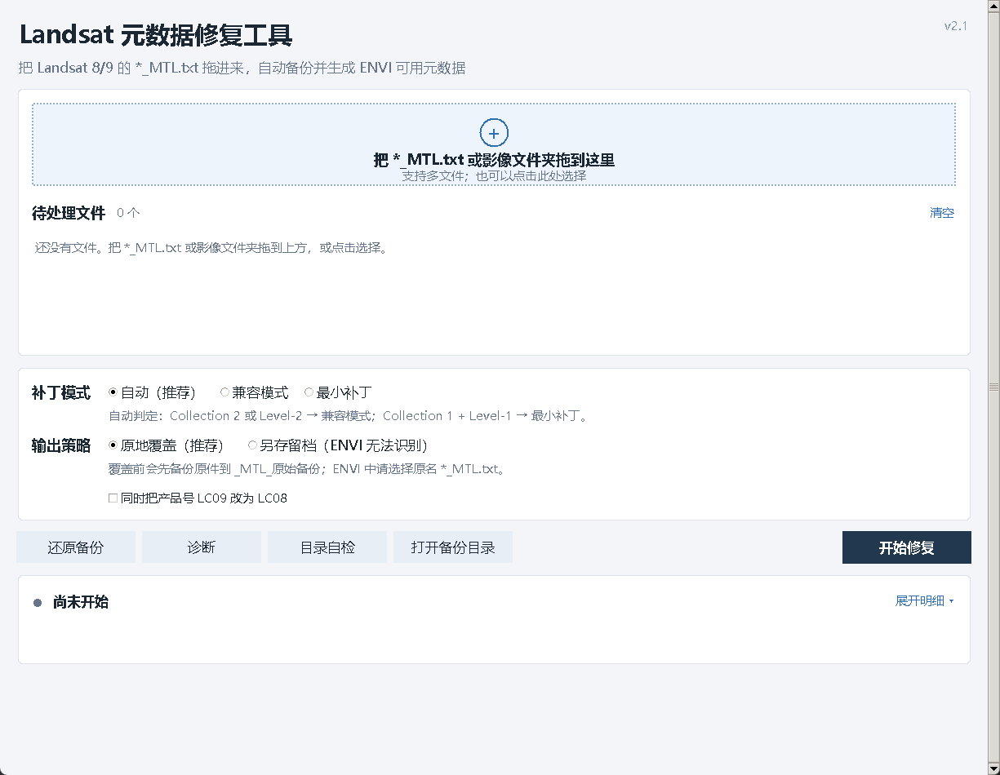
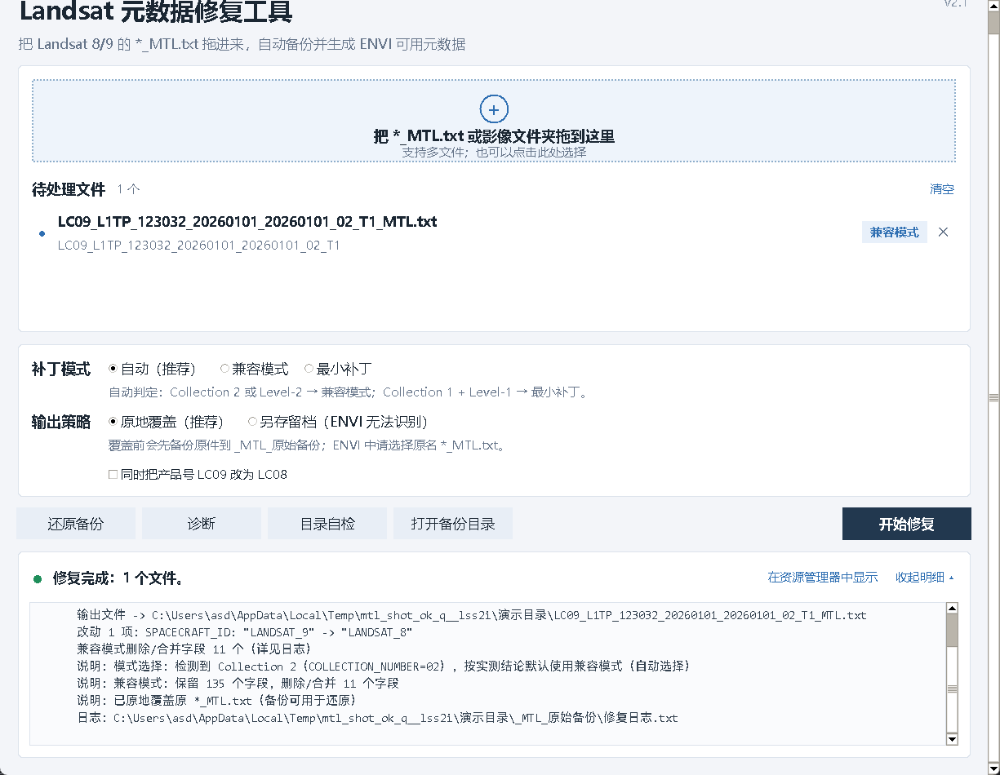
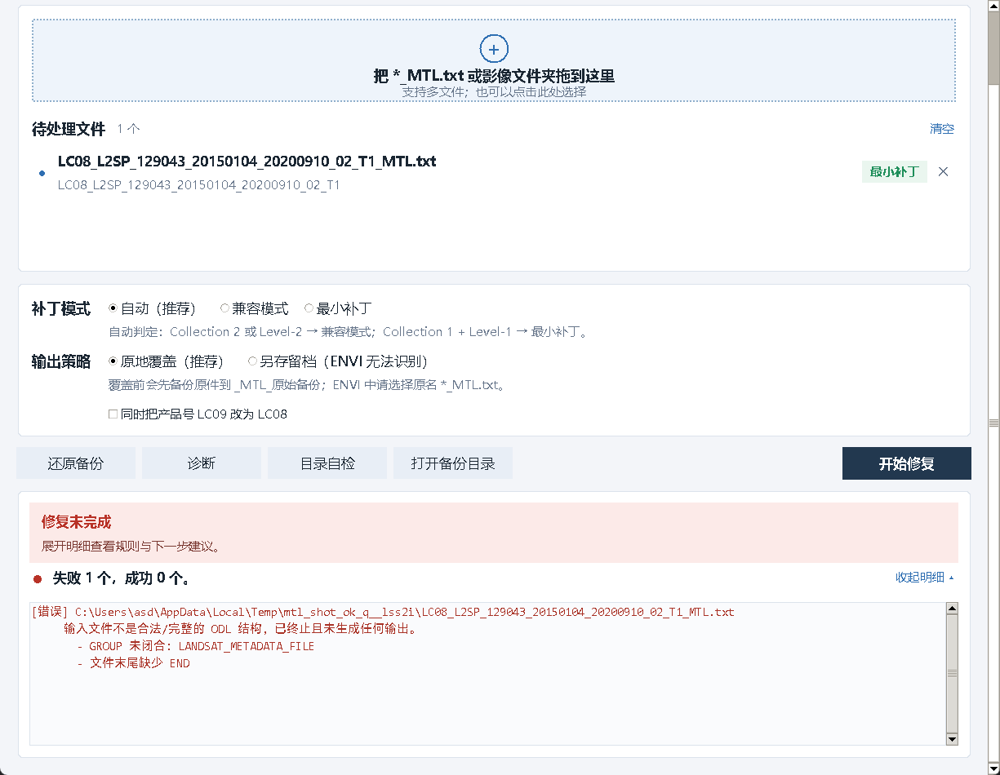

# Landsat 元数据修复工具（ENVI 5.6）

一句话：**把 Landsat 8/9 的 `*_MTL.txt` 拖进来，工具先备份原件，再把修复后的内容原地写回同名 `*_MTL.txt`——ENVI 只认这个文件名。**

> 只改元数据文本，不动任何 TIF、不重命名、不移动文件。

---

## 1. 结论：ENVI 识别失败的主因是文件名

实测（ENVI 5.6 + Landsat 8 Level-2 Collection 2 `LC08_L2SP_129043_20150104_20200910_02_T1_MTL.txt`）：

| 文件名 | ENVI 结果 |
|---|---|
| `*_MTL_ENVI56.txt` | 弹窗 **Unrecognized File Type — Unable to recognize this file as a standard format** |
| 原名 `*_MTL.txt` | 可正常识别 |

ENVI 的 Landsat 读取器按 `*_MTL.txt` 这个命名判定“这是 Landsat 元数据”，改后缀后再正确的内容也会被拒。因此本工具**默认原地覆盖同名 `*_MTL.txt`**；“另存为 ENVI56”只作为留档开关，默认关闭。

**在 ENVI 中必须选择原名 `*_MTL.txt`，不要选任何 `*_MTL_ENVI56.txt`。**

---

## 2. 默认策略

### 2.1 输出方式

| 方式 | 说明 | 默认 |
|---|---|---|
| 原地覆盖 `*_MTL.txt` | 先备份到 `_MTL_原始备份/`，再原子替换同名文件 | ✅ |
| 另存为 `*_MTL_ENVI56.txt` | 不动原件，仅留档/比对；**ENVI 无法识别此命名** | 关闭 |

### 2.2 补丁模式（自动）

| 输入 | 自动选择的模式 | 原因 |
|---|---|---|
| Collection 2（产品号 `_02_T1` / `COLLECTION_NUMBER = 2`） | **兼容模式** | 用户实测兼容模式可在 ENVI 5.6 中打开 C2 L2 数据 |
| Level-2（`L2SP` / `L2SR`） | **兼容模式** | 同上 |
| Collection 1 + Level-1（`LC08_L1TP_..._01_T1` 等） | 最小补丁 | 只改 `SPACECRAFT_ID`，改动最小 |
| 无法判定集合/级别 | 最小补丁（保守） | 若 ENVI 报错，改用 `--compat` |

模式选择原因会写进 `_MTL_原始备份/修复日志.txt` 的 `模式` 一行，界面与命令行也会显示。
需要强制指定时用 `--compat`（强制兼容）或 `--minimal`（强制最小补丁）；两者不能同时使用。

### 2.3 兼容模式保留的 L2 字段

兼容模式把嵌套分组扁平化为 ENVI 5.6 熟悉的 Collection 1 风格（`GROUP = L1_METADATA_FILE`），但下列字段**全部保留、数值不改**：

- 标识与级别：`SPACECRAFT_ID`、`SENSOR_ID`、`PRODUCT_TYPE`、`PROCESSING_LEVEL`、`COLLECTION_NUMBER`、`LANDSAT_PRODUCT_ID` / `PRODUCT_ID`
- 太阳几何：`SUN_AZIMUTH`、`SUN_ELEVATION`、`SUN_*`
- 地表反射率定标：`REFLECTANCE_MULT_BAND_n`、`REFLECTANCE_ADD_BAND_n`、`REFLECTANCE_*`
- 辐亮度/热红外：`RADIANCE_MULT_BAND_n`、`RADIANCE_ADD_BAND_n`、`K1_CONSTANT_BAND_n`、`K2_CONSTANT_BAND_n`
- 量化与饱和：`QUANTIZE_CAL_MIN_BAND_n`、`QUANTIZE_CAL_MAX_BAND_n`、`SATURATION_BAND_n`
- 温度/发射率：`TEMPERATURE_*`、`EMISSIVITY_*`
- 投影：`MAP_PROJECTION`、`DATUM`、`ELLIPSOID`、`UTM_ZONE`、`ZONE_NUMBER`、`CORNER_*`、`*_LINES`、`*_SAMPLES_PER_PIXEL`、`GRID_CELL_SIZE_*`
- 文件与几何：`FILE_NAME_BAND_*`、`WRS_PATH`、`WRS_ROW`、`DATE_ACQUIRED`、`SCENE_CENTER_TIME`、`CLOUD_COVER*`、`IMAGE_QUALITY`

被删除的是不参与 ENVI 建波段栈的说明性字段（例如 `ORIGIN`、`DIGITAL_FORMAT`、`FILE_SOURCE`、`IMAGE_DATE`、`PRODUCT_VERSION` 等），完整删除清单逐次写入日志。

> 说明：本工具目前没有拿到用户真实 MTL 原文做逐字段比对；上表依据构造的 L2 样例与 Collection 2 字段规范整理。**把真实 MTL 发来后可跑一遍对比，补充“保留/删除/改写”的逐字段对照表。**

---

## 3. 用法

### 3.1 拖拽（最省事）

- 把 `*_MTL.txt` 拖到 `修复Landsat元数据.bat` 上（需本机有 Python 3）；
- 或拖到 `exe\Landsat元数据修复工具.exe` 上（无需 Python）。

路径含空格、中文都没问题，可一次拖多个文件。

### 3.2 窗口版（v2.1）

双击 `exe\Landsat元数据修复工具_窗口版.exe`。界面按“三段式”组织：



*正常尺寸启动（空状态）：顶部标题与版本，中部拖拽卡片与文件列表，下方选项、操作栏与一行结果总结。绝对路径：`C:\Users\asd\Documents\Trae-CN\temp_20261104_01\Landsat元数据修复工具\截图\02-正常启动.png`*

| 区域 | 做什么 |
|---|---|
| 顶部 | 标题、副标题、右上角版本号；窗口可缩放、启动按屏幕与缩放比居中 |
| 拖拽卡片 | 大号虚线框，拖入时高亮变色；窄窗口自动降高；支持多文件或整个影像文件夹，也可点击选择；下方列表显示文件名、景号、模式徽标，单条 ✕ 可移除 |
| 选项卡片 | 补丁模式（自动 / 兼容模式 / 最小补丁，附自动判定小字）、输出策略（原地覆盖 / 另存留档）、产品号开关；控件按列对齐 |
| 操作栏 | 还原备份、诊断、目录自检、打开备份目录（同宽同高）；右侧深蓝主按钮“开始修复” |
| 结果区 | 默认一行结论 + 一行建议；“展开明细”打开独立可滚动的等宽字日志区（信息/警告/错误分级），失败时红色横幅并自动展开 |


*窗口缩到最小时点开“展开明细”：整页可滚动，结果区横幅、总结行与明细文本都完整可见，明细区内还有独立滚动条。绝对路径：`C:\Users\asd\Documents\Trae-CN\temp_20261104_01\Landsat元数据修复工具\截图\01-小窗口展开明细.png`*



*修复成功：总结变绿，并出现“在资源管理器中显示”；明细里给出模式、备份与日志路径。绝对路径：`C:\Users\asd\Documents\Trae-CN\temp_20261104_01\Landsat元数据修复工具\截图\03-修复成功.png`*



*修复失败：红色横幅给出下一步建议，自动展开明细；错误带 `[错误]` 前缀，traceback 默认折叠可展开。绝对路径：`C:\Users\asd\Documents\Trae-CN\temp_20261104_01\Landsat元数据修复工具\截图\04-修复失败.png`*

交互细节：

- 处理中按钮全部禁用，显示不确定进度条与当前文件名；长任务在后台线程执行，界面不冻结；
- 完成后绿色/琥珀/红色状态色区分成功、警告、失败；失败摘要会建议展开明细或先“诊断”；
- 明细区为独立滚动文本（Consolas 等宽字体、行距舒适），滚轮在 Windows 下可用；日志按 `[信息]/[警告]/[错误]` 前缀分级着色，traceback 默认折叠；
- 整页兜底滚动：窗口再小也能滚到标题、拖拽区、选项、操作栏与结果区，不会被裁掉；
- 展开明细时若未手动调过窗口，会按内容自动增高（上限屏幕可用高度 90%），收起恢复；手动调过则尊重用户尺寸，只做内容滚动；
- 窗口大小与位置记忆在 `%APPDATA%\LandsatMTLRepair\settings.json`（读失败或不合法则回落默认），下次启动沿用；
- `Enter` 开始修复，`Esc` 关闭窗口；
- 已适配 Windows 高 DPI（125%/150% 不拉伸变糊），字体缩放跟随系统。

**常见操作路径**

1. **首次修复**：拖入 `*_MTL.txt` → 确认列表徽标（L2/Collection 2 应为“兼容模式”）→ 点“开始修复” → 看到绿色总结后点“在资源管理器中显示” → 在 ENVI 中选择原名 `*_MTL.txt`。
2. **修复后 ENVI 仍打不开**：点“诊断” → “展开明细”复制结果 → 或点“还原备份”回到原件，把诊断结果反馈给维护者。
3. **怀疑选错文件**：点“目录自检”，若提示“同时存在”，在 ENVI 中必须选原名 `*_MTL.txt`；只有 ENVI56 版本时自检会直接告警。

### 3.3 命令行

```bat
python fix_mtl.py "D:\data\LC08_..._MTL.txt"            :: 默认：自动模式 + 原地覆盖
python fix_mtl.py --compat "D:\data\..._MTL.txt"         :: 强制兼容模式
python fix_mtl.py --minimal "D:\data\..._MTL.txt"        :: 强制最小补丁
python fix_mtl.py --envi56 "D:\data\..._MTL.txt"         :: 另存 ENVI56（仅留档，ENVI 打不开）
python fix_mtl.py --restore "D:\data\..._MTL.txt"        :: 从备份还原
python fix_mtl.py --diagnose "D:\data\..._MTL.txt"       :: 只诊断，不改文件
python fix_mtl.py --self-check "D:\data"                 :: 检查目录里是否选错 ENVI56 文件
python fix_mtl.py --make-hdr "D:\data"                   :: 兜底：从 TIF 生成 .hdr
```

### 3.4 诊断模式（一条命令贴回结果）

```bat
python fix_mtl.py --diagnose "D:\data\LC08_L2SP_..._MTL.txt"
```

输出：文件大小/编码/行尾、`SPACECRAFT_ID`、`SENSOR_ID`、产品号、Level、Collection、日期、WRS、ODL 校验结果、每个 `FILE_NAME_BAND_*` 指向的文件 `[存在]/[缺失]`、目录中实际 TIF 数量、完整分组清单、结论。可直接整段复制反馈。

### 3.5 目录自检

```bat
python fix_mtl.py --self-check "D:\data"
```

检查目录里是否同时存在原名 `*_MTL.txt` 与 `*_MTL_ENVI56.txt`，提示“ENVI 中该选哪个”；只有 ENVI56 时直接告警：ENVI 打开必然失败。

---

## 4. 备份、日志与还原

- 备份位置：影像文件夹下的 `_MTL_原始备份\`；
- 备份名：`LC08_..._T1_MTL_原始备份_20261104_103000.txt`（时间戳 + 必要时 `_2`），刻意不以 `_MTL.txt` 结尾，避免 ENVI 扫描时误选；
- 备份是原件的完整字节副本（含 BOM/CRLF），并做 SHA-256 校验；
- 任何写入之前先备份；备份失败则绝不覆盖原件；
- 写入采用“同目录临时文件 + 原子替换”，失败时原件保持不变；
- `_MTL_原始备份\修复日志.txt` 记录：时间、原文件、备份、输出、**模式及选择原因**、改动明细、删除清单、缺失 TIF、警告、`原文件已被覆盖：是/否`、还原入口；
- 还原：窗口版“从备份还原…”或 `--restore`。还原会优先选取最近一份**未打过补丁**的备份（避免多次运行后还原到修复版），写回前把当前文件另存为 `..._MTL_还原前_<时间戳>.txt`；日志记录“原文件已被覆盖：是”。

---

## 5. 在 ENVI 5.6 中打开

1. 确认目录里是原名 `*_MTL.txt`（不确定就先跑 `--self-check`）；
2. ENVI 菜单：`File → Open As → Optical Sensors → Landsat → GeoTIFF with Metadata`；
3. 选择 **`*_MTL.txt`**；
4. ENVI 按 `FILE_NAME_BAND_*` 自动加载同目录 TIF，并读取投影与定标系数。

若没有 `GeoTIFF with Metadata` 菜单，可直接 `File → Open` 选 MTL。

---

## 6. 兜底方案：完全不依赖 MTL

```bat
python fix_mtl.py --make-hdr "D:\data"           :: 为目录内每个波段的 TIF 生成 .hdr
python fix_mtl.py --make-hdr --hdr-overwrite "D:\data"
```

- 本工具采用**纯标准库**方案：直接解析 GeoTIFF 的 `ModelPixelScale`、`ModelTiepoint`、`GeoKeyDirectory`（EPSG），写出 ENVI `.hdr`（samples/lines/bands、data type、byte order、map info、波长）；
- 未使用 GDAL/rasterio（本机不依赖）；如本机装有 GDAL，也可先用 `gdal_translate` 生成，两者不冲突；
- 纯标准库方案的精度风险：EPSG 只能反推 UTM 带号/半球与常见基准面（WGS-84 / NAD-27 / NAD-83），自定义投影、非 UTM 投影、复杂基准面可能退回 `map info` 缺失或近似；`RPC`、`GEOTRANS` 等标签不处理；
- 用法：ENVI 里逐个打开带 `.hdr` 的单波段 TIF，再用 `Layer Stacking` 合成波段栈；
- 该功能是**可选**的，不进入默认流程。

---

## 7. 安全与幂等

- 默认先备份、再原地覆盖；第二次运行检测到 `SPACECRAFT_ID` 已是 `LANDSAT_8`，仍会先备份（备份内容为当前修复版），再写出逐字节一致的内容，不会叠改；
- 输出前校验文件名必须以 `_MTL.txt` 结尾，否则拒写并给出中文错误（`*.MTL` 原地写会被拒绝，可改用 `--envi56` 留档）；
- 输入 ODL 不合法（分组未闭合、引号未闭合、缺 `END`）时直接报错，不产生备份目录和输出文件；
- 输入 BOM/UTF-16/GBK 自动识别；输出统一 UTF-8 无 BOM；行尾按输入主导风格保持；
- 只写 MTL、备份与日志，不碰 TIF 和其他文件。

---

## 8. 仍需在 ENVI 中确认的点

本工具没有 ENVI 环境，无法端到端验证。若仍有问题，请提供：

1. **ENVI 具体小版本**（Help → About，例如 5.6.0 / 5.6.1 / 5.6.2）；
2. 数据类型：L1 还是 L2（L2SP/L2SR），Collection 1 还是 2；
3. 报错**原文**（弹窗完整文字与截图）；
4. `--diagnose` 的完整输出；
5. 如方便，提供该景真实 `*_MTL.txt`，用于逐字段对比并补全本文档的对照表。

参考：

- [ENVI Supported Data Types](https://envi.geoscene.cn/help/Subsystems/envi/Content/ExploreImagery/SupportedFormats.htm)
- [Landsat 数据打开助手](https://envi.geoscene.cn/appstore/opeldtsant/)
- [USGS Landsat Collection 2 Data Dictionary](https://www.usgs.gov/centers/eros/science/landsat-collection-2-data-dictionary)

---

## 9. 交付文件

```
Landsat元数据修复工具\
├─ fix_mtl.py                      核心脚本（纯标准库，未随 UI 改动）
├─ 修复Landsat元数据.bat           拖拽启动器（纯 ASCII）
├─ gui_mtl.py                      窗口版 v2.1（整页滚动 + 可滚动明细 + 尺寸记忆）
├─ 使用说明.md / 测试记录.md
├─ exe\
│   ├─ Landsat元数据修复工具.exe
│   └─ Landsat元数据修复工具_窗口版.exe
├─ 截图\                           01-小窗口展开明细 / 02-正常启动 / 03-修复成功 / 04-修复失败
├─ tests\
│   ├─ test_fix_mtl.py             20 项修复逻辑测试
│   └─ test_gui.py                 12 项窗口版界面测试（含 DPI/滚动/设置纯函数）
└─ 测试样例数据\                    构造的 C2 L1 样例 + 占位 TIF + 演示目录
```

运行环境：Windows；`fix_mtl.py` 需 Python 3.8+（仅标准库）；窗口版需 tkinter（自带），`tkinterdnd2` 可选；exe 由 PyInstaller 6.22.3 单文件打包，目标机无需 Python。
